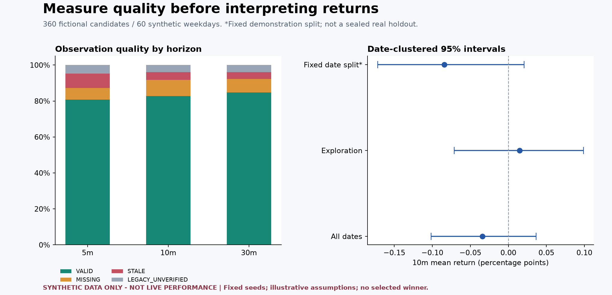
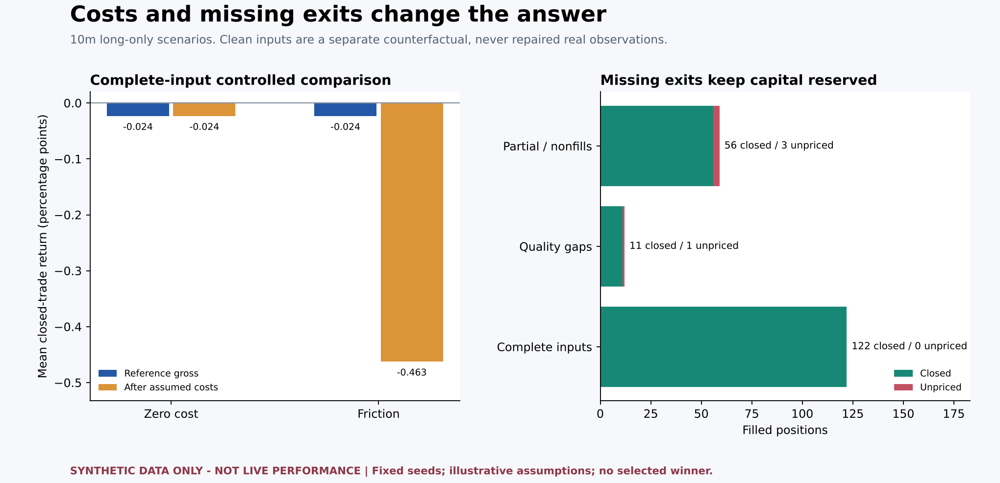
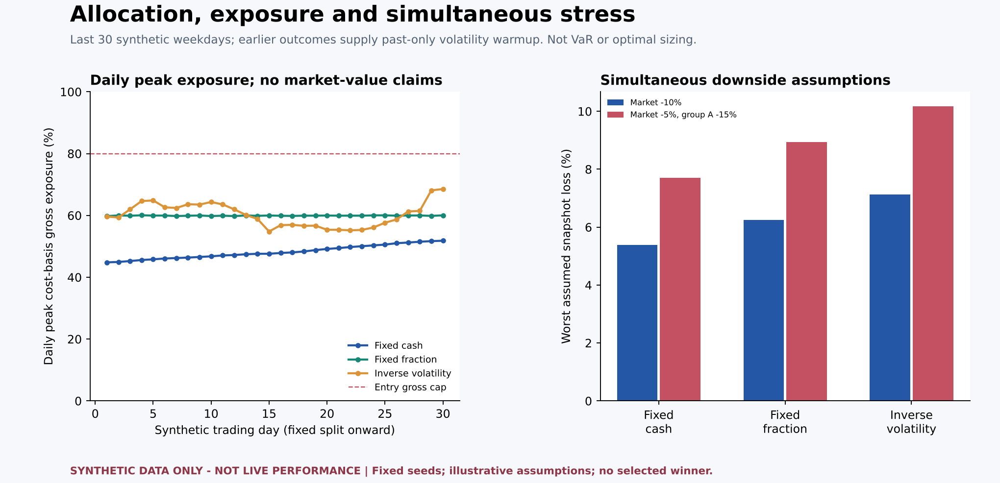
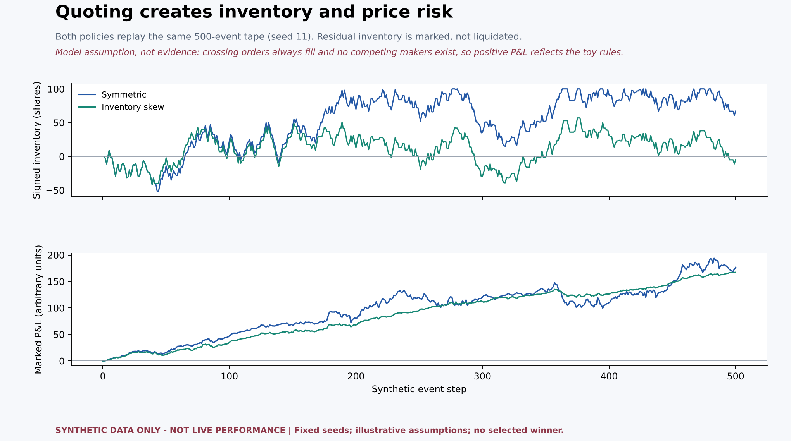

# Trading Research Lab

An offline Python toolkit for evaluating trading signals **honestly**: it makes the quality of the data, the cost of execution and the statistical uncertainty visible before any number is trusted.

Built around short-horizon (5/10/30-minute) signal research on Korean equities, with transferable research methods. Core calculations and P1–P4 report CLIs use only the standard library; 96 automated tests. The legacy CSV import helper optionally requires pandas.

> **This is a research tool, not investment advice.** Nothing here establishes that any strategy is profitable. Every report is labeled *exploratory*; there is no "edge" verdict, p-value, or automatic winner selection. Example parameters are illustrative, not current fees, tax rates or recommendations.

**Jump to:** [What it does](#what-it-does) · [Synthetic example](#synthetic-example-inspect-the-output-first) · [Quick start](#quick-start) · [Limitations](#limitations)

## What it does

| Stage | Question it answers | Document |
|---|---|---|
| **P0 Data integrity** | Can I trust the recorded returns? | [P0_DATA_INTEGRITY.md](P0_DATA_INTEGRITY.md) |
| **P1 Statistical validation** | Does the result persist across many days, with what uncertainty? | [P1_STATISTICAL_RESEARCH.md](P1_STATISTICAL_RESEARCH.md) |
| **P2 Execution & cash simulation** | What is left after fees, tax, spread, slippage and partial fills? | [P2_EXECUTION_SIMULATION.md](P2_EXECUTION_SIMULATION.md) |
| **P3 Allocation & concentration** | How much to allocate, and what risk does the book carry? | [P3_PORTFOLIO_RISK.md](P3_PORTFOLIO_RISK.md) |
| **P4 Market-making lab** | What would a causal quoting policy earn and risk? | [P4_MARKET_MAKING.md](P4_MARKET_MAKING.md) |

## Synthetic example: inspect the output first

**Synthetic data only — not live performance.** Explore a reproducible 60-day, 360-candidate example covering data quality, uncertainty, costs, missing exits, allocation stress and market-making inventory.

[Read the full example report](examples/synthetic/README.md) · [Reproduce it](examples/generate_synthetic_demo.py) · [Audit inputs and hashes](examples/synthetic/manifest.json)

### 1. Data quality and uncertainty



Missing, stale and unverified observations are counted per horizon and never zero-filled. Intervals resample whole dates, and the ones shown here include zero.

### 2. Costs and missing exits



Assumed fees, tax, spread and slippage turn a near-zero gross result into a clearly negative net one. Positions with no priced exit stay open with their cash reserved.

### 3. Allocation and simultaneous stress



Three sizing rules compared on daily peak exposure and on compounded market + sector shocks. Cost-basis exposure only; not VaR.

### 4. Market-making inventory



An inventory-skewed quoting policy holds less residual inventory than symmetric quotes on the same tape. Positive P&L here reflects the toy model's assumptions (every crossing order fills, no competitors), not evidence of a profitable strategy.

The sample includes negative cost-adjusted results and deliberately unpriced exits; it does not select or advertise a profitable strategy. All inputs, symbols and assumptions are fictional. Plot generation uses the optional dependency in `examples/requirements.txt`; the research engines keep their existing dependencies.

## Design principles

- **Observation quality is explicit.** Each horizon is `VALID`, `STALE`, `MISSING`, `OUT_OF_SESSION`, and so on. Missing outcomes are never zero-filled, and a late quote never passes as a clean return.
- **No look-ahead.** Sizing uses only outcomes completed strictly before the decision; market-making quotes use only previously observed prices; future markouts are diagnostics, never inputs.
- **Honest uncertainty.** Date-clustered bootstrap confidence intervals, explicit `INSUFFICIENT_DATA` / `DEGENERATE` flags, holdout splits, exact-interval benchmark matching.
- **Unknown stays unknown.** Unfilled exits stay open and keep cash reserved; terminal equity is `null` rather than invented.
- **Read-only and reproducible.** Analysis CLIs open SQLite read-only, never create or migrate a database, and emit input/config fingerprints and seeds.

## Quick start

Tested on Python 3.12 and 3.14. No credentials, real data or third-party packages are needed for tests and the SQLite walkthrough.

```bash
# Create a synthetic SQLite database and run P1, P2 and P3 in one command:
python examples/run_research.py

# Verify the committed example outputs:
python examples/verify_artifacts.py
```

Results are written to `demo_output/`: synthetic input DB, Markdown/JSON reports and input hashes. Use `--output PATH` for a different empty directory; existing results are never overwritten. Missing exits intentionally produce null terminal equity.

Optional dependencies: plotting uses `python -m pip install -r examples/requirements.txt`; the legacy `import_signal_research_csv_to_db.py` helper uses `python -m pip install -r requirements-import.txt`. Neither is required for the walkthrough or tests.

```bash
python -m unittest discover -s tests -v          # 96 tests, no network, no accounts

# P4 needs no database:
python market_making_report.py --config simulation/market_making.example.json \
    --output market_making_report.md --json-output market_making_report.json
```

P1–P3 read a SQLite database in the schema defined by `database.py` (table `signal_research`, view `canonical_signal_research`). No database is included; the tests use synthetic data.

```bash
# P1: statistics, optional holdout and benchmark
python quant_research_report.py --db trading_engine.db --output quant_report.md

# P2: cost / fill / cash scenarios
python execution_simulation_report.py --db trading_engine.db \
    --config simulation/scenarios.example.json --horizon 5 --output execution_report.md

# P3: allocation x execution comparison with simultaneous-shock stress
python portfolio_risk_report.py --db trading_engine.db \
    --config simulation/allocation.example.json --horizon 5 --output portfolio_report.md
```

## Engineering choices

[Read the design decisions and validation cases](ENGINEERING_NOTES.md): observation timing, unresolved exits, clustered uncertainty and past-only sizing.

## Method highlights

- **P1:** observation-weighted and equal-weight-per-date means; 95% percentile bootstrap that resamples whole entry dates (default seed 1729, 2,000 resamples, at least 30 observations over 20 dates); quantiles; per-date results; benchmark excess return only on exact timestamp pairs.
- **P2:** `buy = E(1+a)`, `sell = X(1-a)` with `a = (spread_bps/2 + slippage_bps)/10,000`; whole shares; fee-inclusive budgets; seeded fill draws independent of future returns; realized-loss and consecutive-loss latches; per-trade identity `gross − adverse-price cost − fees/tax = net`.
- **P3:** fixed-cash, fixed-fraction and inverse-volatility sizing from past-only signal-return history; symbol / sector / gross caps; sector HHI; compounded market + sector shocks (−10% and −20% compound to −28%).
- **P4:** EWMA fair value, inventory-skewed bid/ask, tick rounding, bounded short inventory, drawdown halt that does not fake liquidation, and the identity `quoted_edge + fair_revaluation − fees = marked_pnl`.

## Limitations

- Costs, fill probabilities, flow models and sector labels are **assumptions**. They are not calibrated to a real order book, queue, market impact or broker fee schedule.
- Research timestamps are receipt times, not exchange trade times.
- The public observation validator assumes weekday KST regular-session hours; it does not include a complete exchange holiday/special-session calendar.
- P3 stress uses entry reference prices and cost-basis exposure, not mark-to-market values or an empirical correlation matrix. It is not VaR.
- P4 is a toy single-asset model with synthetic or supplied event tapes.
- The live quote collector that produces P0 observations is not part of this repository.

## Repository layout

```text
database.py                     schema, migrations, dedup, canonical view, CSV export
quant_research_report.py        P1 CLI           research/statistical_analysis.py
execution_simulation_report.py  P2 CLI           simulation/execution_simulator.py, risk_simulator.py
portfolio_risk_report.py        P3 CLI           simulation/portfolio_allocation.py
market_making_report.py         P4 CLI           simulation/market_making_simulator.py
export_signal_research.py, import_signal_research_csv_to_db.py
simulation/*.example.json       illustrative configs
tests/                          96 tests on synthetic data
```

## License

MIT. See [LICENSE](LICENSE).
