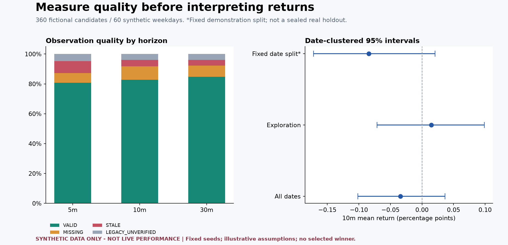
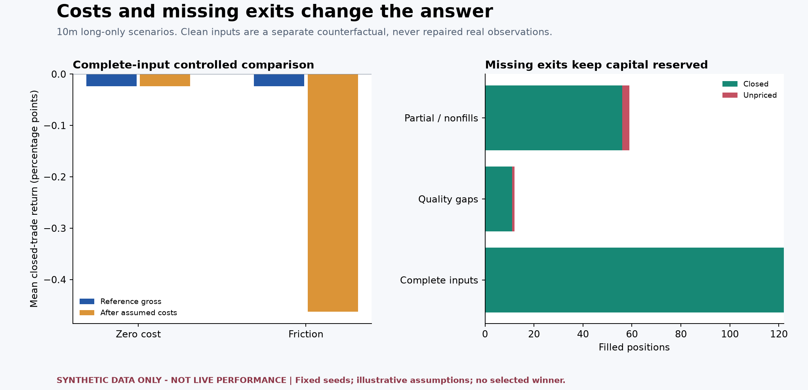
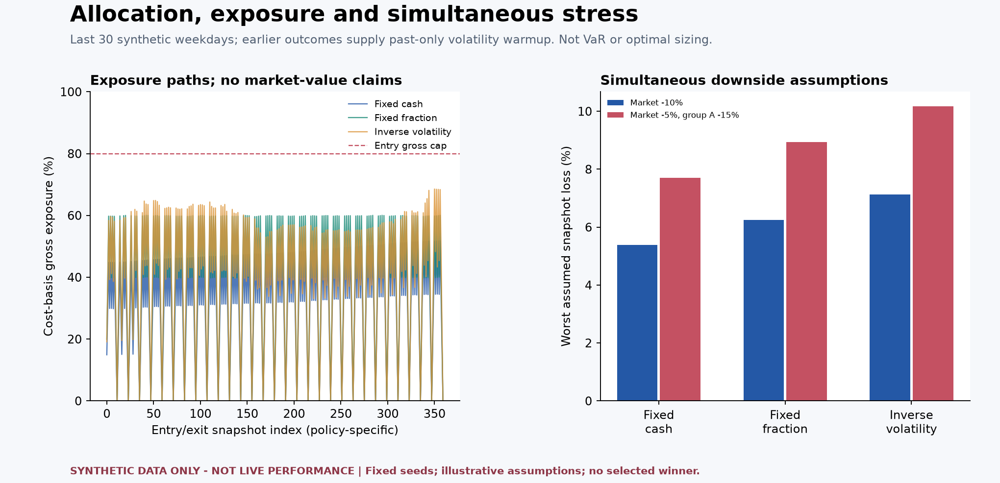
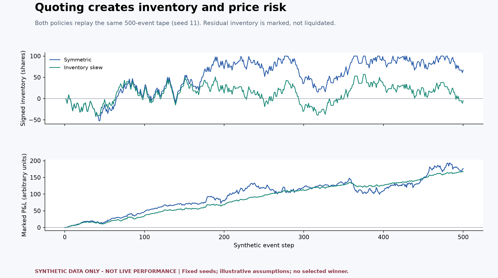

# Synthetic research walkthrough

> **SYNTHETIC DATA ONLY - NOT LIVE PERFORMANCE**

This is an executable demonstration of research safeguards, not evidence of a profitable strategy. No real market, account, broker, private signal rules or trading records are used.

## Reproduce

From the repository root:

```bash
python -m pip install -r examples/requirements.txt
python examples/generate_synthetic_demo.py
```

The research engines remain standard-library-only. Matplotlib is an optional dependency of this example generator; `--no-plots` rebuilds data/reports without it. Fixed seeds reproduce values with the same Python/runtime versions. No database or credentials are needed.

## Dataset and assumptions

- Seed: `20261109`; 60 synthetic weekdays beginning 2025-01-06; six candidates per day; 360 total.
- Fixed exploration/holdout date boundary: `2025-02-17`. This synthetic calendar skips weekends only, not actual exchange holidays.
- All symbols (`SYNTH_01`–`SYNTH_03`), setup labels and groups are fictional.
- Gross returns combine fictional shared day shocks and Gaussian noise, with no embedded profitable strategy or tuned winner.
- Complete and quality-stressed datasets share latent simulated prices. Independent quality masking creates approximately 8% missing, 6% stale and 4% legacy rows per horizon; realized counts vary by seed.
- Complete inputs are a separate controlled counterfactual, **not** a filtered surviving subset or a repair procedure for real missing data.
- Costs and fill probabilities below are fictional assumptions. Monetary values use arbitrary simulation units.
- P2 deliberately permits an entire 100,000-unit account per entry (100% common cap), with at most three positions, ten filled entries per day and very loose demonstration loss stops. This concentrates turnover and cost drag; it is not a proposed risk policy. P3 instead applies its separate symbol/sector/gross allocation caps.

## 1. Quality and uncertainty



| Horizon | Valid / total | Coverage | Mean gross return (pp) | 95% date-cluster CI (pp) |
|---|---:|---:|---:|---|
| 5m | 291 / 360 | 80.8% | 0.0030 | [-0.0449, 0.0555] |
| 10m | 298 / 360 | 82.8% | -0.0340 | [-0.1015, 0.0365] |
| 30m | 305 / 360 | 84.7% | 0.0282 | [-0.0762, 0.1422] |

Intervals resample whole dates (1,000 replications). Missing/stale/legacy records are excluded independently per horizon and never zero-filled. The illustrative split and confidence intervals do not seal a holdout, correct multiple comparisons, or establish an edge.

## 2. Costs, partial fills and unknown exits



| Input / scenario | Filled | Closed | Unpriced | Closed gross mean (pp) | Closed net mean (pp) | Terminal return % |
|---|---:|---:|---:|---:|---:|---:|
| Complete / zero cost | 122 | 122 | 0 | -0.0236 | -0.0236 | -2.9351 |
| Complete / friction | 122 | 122 | 0 | -0.0236 | -0.4627 | -43.2540 |
| Complete / partial and nonfills | 59 | 56 | 3 | 0.0456 | -0.3938 | N/A (unpriced positions) |
| Quality gaps / friction | 12 | 11 | 1 | -0.0144 | -0.4537 | N/A (unpriced positions) |

Friction assumptions: buy fee 2 bps, sell fee 2 bps, sell tax 20 bps, full spread 10 bps and additional slippage 5 bps per side. Controlled cost comparison assumes complete fills; the separate partial/nonfill case assumes entry probability 0.8, entry fraction 0.5 and exit probability 0.95. These are **not current rates or calibrated execution estimates**.

Missing exits do not prevent a hypothetical entry in advance. Filled positions keep their cash reserved. Terminal returns remain null while any position is unpriced. Closed-only averages are conditional and can be selection-biased.

## 3. Allocation and simultaneous downside



| Allocation | Filled | Peak gross exposure | Peak sector exposure | Market -10% assumed loss |
|---|---:|---:|---:|---:|
| fixed_cash | 180 | 51.8% | 34.5% | 5.39% |
| fixed_fraction | 180 | 60.0% | 40.1% | 6.24% |
| volatility_target | 180 | 68.5% | 45.5% | 7.12% |

The three policies share the friction assumptions and start fresh capital on the fixed split date. Earlier clean synthetic observations provide warmup, but only outcomes completed strictly before a decision enter inverse-volatility sizing. Exposure is cost-basis, not marked market value. Stress compounds market and group shocks from entry references and assumes liquidation; it is not VaR, a probability or a live loss bound.

## 4. Inventory-aware market making



| Policy | Fills | Ending inventory | Marked P&L | Fees | Mean future markout per fill |
|---|---:|---:|---:|---:|---:|
| Symmetric | 398 | 67 | 176.6125 | 27.9477 | 0.6320 |
| Inventory skew | 375 | -5 | 167.4331 | 26.7422 | 0.5459 |

Both policies see the same seed-11 tape. Quotes use previous observations; future markouts are post-run diagnostics. Ending inventory is marked at the final synthetic midpoint, not liquidated. The tape omits queue competition, measured latency, market impact and actual borrowing constraints. No winner is selected.

## Audit trail

- [Input data](synthetic_inputs.json): complete counterfactual and quality-stressed records.
- [Statistics](statistics.json) and [full statistical details](statistics.md).
- [Execution decisions and ledgers](execution.json).
- [Allocation assumptions, decisions and snapshots](allocation.json).
- [Market-making assumptions, quotes, fills and ledger](market_making.json).
- [Manifest and file hashes](manifest.json).

These files are generated solely from the checked-in demo, public research engines and explicit constants. They contain no API keys, account identifiers, real trades, internal entry rules or inferred real performance.
